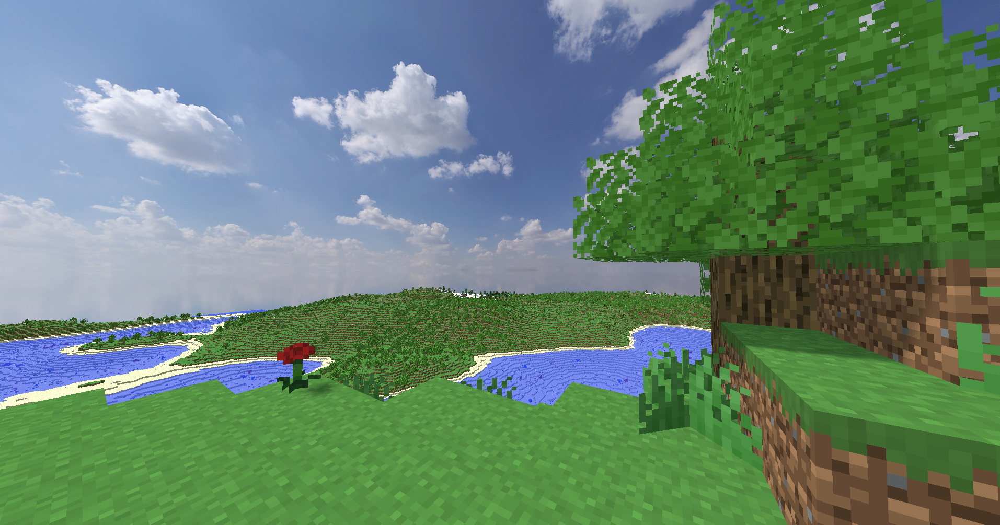

# Minecraft Clone From Scratch C++/OpenGL

A from-scratch recreation of Minecraft's core gameplay, built entirely in **C++** and **OpenGL** without using any commercial game engine (Unity, Unreal, etc.). The project started by developing a small custom 3D engine ([graphics-engine](https://github.com/prof-redstone/graphics-engine)), then evolved into a fully functional block-based voxel world with procedural terrain generation, chunk streaming, real-time shadows, and basic player interaction.

## Features

- **Chunk-based world** – World split into 30×120×30 voxel chunks, streamed in/out around the player with a configurable render distance (K/L to adjust at runtime).
- **Procedural terrain** – 3D Perlin noise terrain generation using [db-perlin](https://github.com/daniilsjb/perlin-noise). Terrain blends height, oceanicity, flatness and "weirdness" parameters to create natural shapes.
- **Biomes** – Three distinct biomes: Plains, Snow/Taiga, and Desert. Each biome has its own surface blocks, shore materials, underwater vegetation and decorations.
- **Block system** – 29 block types (stone, dirt, grass, sand, snow, glass, ores, wood, leaves, cactus, water, plants, corals, ice, bedrock). Block properties control solidity, transparency, whether to render the inside faces, plant/cross shapes, and shadow casting.
- **World generation & decorations** – Procedural tree placement (Oak and Spruce with multiple variants), cacti, short grass, flowers, sweet berries, kelp and corals. Structures are defined as templated block placements (`structure.h`).
- **Block placement & destruction** – Left/right mouse click to break and place blocks. Raycasting uses voxel traversal with a maximum reach of 7 blocks.
- **Player movement & collision** – Fly mode (default, `F`) and walk mode (`Z`) with gravity, jump, grounded detection and simple axis-aligned collision against solid blocks.
- **Real-time rendering** – Face-culling with neighbour-aware meshing to avoid gaps at chunk borders (neighbour chunks are re-meshed on load/edge edits).
- **Transparency** – Opaque and transparent geometry are drawn in separate passes. Transparent meshes are rendered last with depth writes disabled to handle semi-transparent blocks (water) correctly.
- **Dynamic lighting** – Per-fragment Phong shading with multiple lights. Two directional lights simulate sun and skylight (intensity 0.62 and 0.2). Up to 8 lights supported in the rendering pipeline.
- **Shadow mapping with PCF** – Real-time shadows for shadow-casting lights (directional + point). Uses percentage-closer filtering (PCF) with a distance-adaptive kernel, slope-scaled depth bias, front-face culling in the depth pass, and camera-relative snapping to reduce shadow flickering. Edge fade-out hides hard shadow-map boundaries.
- **Water & underwater effects** – Semi-transparent water rendering with an underwater blue tint overlay when the camera is inside water.
- **Plants with wind** – Vertex-shader wind animation on plants (cross-shape vegetation), smoothly disabled beyond ~30m for performance.
- **Skybox** – Cubemap skybox rendered first with depth function `GL_LEQUAL`.
- **Performance-minded streaming** – Chunk loading/unloading queues processed at a limited rate per frame (max 2 loaded + 2 unloaded) to keep framerates stable. Meshes are reused and buffers shrink on unload.
- **Floating-origin rendering** – Geometry is rendered relative to the camera to avoid floating-point precision issues at large world distances.

## Controls

| Key | Action |
|---|---|
| `W`, `A`, `S`, `D` | Move forward/left/backward/right |
| `Q`, `E` | Move down/up |
| `Space` | Jump (walk mode) |
| `Mouse` | Look around |
| `Left Mouse` | Destroy block |
| `Right Mouse` | Place selected block |
| `1–8` | Select block (Stone, Glass, Oak Planks, Dirt, Oak Log, Grass, Diamond Ore, Oak Leaves) |
| `F` | Toggle Fly mode |
| `Z` | Toggle Walk mode |
| `O` / `P` | Decrease/Increase movement speed |
| `K` / `L` | Decrease/Increase render distance |
| `N` | Toggle UI/block highlight |
| `Arrow Keys` | Fine camera rotation |
| `Esc` | Quit |

## Technical Highlights

- **Chunk seam handling**: Before culling faces, the mesher checks all 4 neighbouring chunks (and remeshes neighbours on edge edits/load) to produce crack-free geometry across chunk boundaries.
- **Shadow stability**: Light-space matrix uses camera-relative `fract(camera.Position*...)` snapping to minimise shadow shimmering, combined with PCF and an edge fade-out.
- **5-draw-list meshing**: Meshes are split into opaque, opaque-no-shadow, transparent, transparent-no-shadow and plant to minimise draw calls and avoid incorrect shadow casters (glass/water excluded from depth pass).
- **Depth-aware PCF**: Shadow kernel radius decreases with fragment distance to balance quality and performance.

## Built With

- [GLFW](https://www.glfw.org/) – Windowing & input
- [GLEW](https://glew.sourceforge.net/) – OpenGL function loading
- [GLM](https://glm.g-truc.net/) – Math library
- [stb_image](https://github.com/nothings/stb) – Image loading
- [db-perlin](https://github.com/daniilsjb/perlin-noise) – Perlin noise implementation
- [graphics-engine](https://github.com/prof-redstone/graphics-engine) - Rendering architecture forked from my own

## Building

- This project was built with **Visual Studio 2022**. The required dependencies (GLFW, GLEW, GLM) are vendored under `GLFW/`, `GLEW/` and `glm/`. OpenGL32 is linked system-wide.
- Run `minecraft.exe` in `x64/Release/`

## License

This is a personal educational project. Feel free to explore, learn from or reference the code.